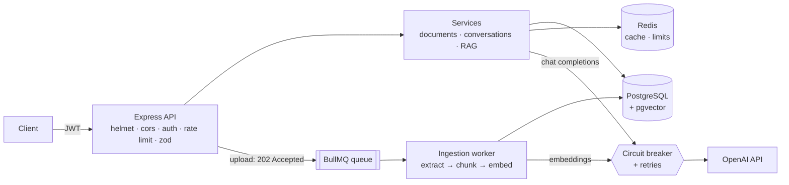

# DocuChat

**Chat with your documents.** Upload a PDF, Markdown or text file, ask a question, and get an answer drawn only from that document, with citations to the passages it came from.

DocuChat is a production-style TypeScript backend for Retrieval-Augmented Generation (RAG). It is the guided project from the **[Mastering Backend](https://masteringbackend.com) AI Engineering Bootcamp**: I built it lesson by lesson alongside the instructor, Solomon Eseme, then cleaned it up into one coherent codebase.

```
POST /api/v1/conversations/:id/messages   {"content": "What is the refund window?"}

→ "Items can be returned within 30 days [Source 1], and refunds need a receipt [Source 2]."
   citations: [1] Returns Policy, Section 3   [2] Handbook, Section 12
```

---

## How it works



**Upload (async).** `POST /documents` saves the file with status `pending`, queues a job and returns **202** straight away. A worker extracts the text, chunks it (recursive splitting with overlap), embeds the chunks in batches, and stores the vectors in pgvector. The client polls `/documents/:id/processing-status` for progress (0–100).

**Ask (sync).** `POST /conversations/:id/messages` embeds the question, runs a cosine-similarity search over **only this user's** chunks, drops anything below a relevance floor, packs the best chunks into a token budget, and asks the model to answer from that context only, citing `[Source N]`. If nothing relevant is found, it says so instead of guessing, and the model is never called.

## Features, by bootcamp week

| Week | What's implemented |
|---|---|
| **1. API foundations** | JWT access tokens (15 min) + rotating refresh tokens (stored as SHA-256 hashes), bcrypt passwords, an event bus for side effects, REST conventions, Zod validation on every input, a standard `{ success, data, error }` envelope, `/api/v1` versioning, Swagger docs |
| **2. Business logic & jobs** | Layered architecture (routes → controllers → services), tier-based permissions, paginated, filterable and sortable lists without N+1 queries, transactions, soft delete with an audit trail, BullMQ queue with exponential backoff and a dead-letter queue, Bull Board dashboard, Axios client with timeouts and interceptors, retries that respect `Retry-After`, an opossum circuit breaker |
| **3. Production hardening** | Redis cache-aside with stampede protection and event-driven invalidation, ETags, Redis-backed tiered rate limits (auth, API, upload, chat), XSS sanitisation, prompt-injection detection, Helmet CSP, locked-down CORS, secret scrubbing in logs, Winston structured logs with correlation IDs, Prometheus metrics, liveness and readiness probes |
| **4. AI layer** | pgvector + HNSW index, batched embeddings with a content-hash cache, PDF/Markdown/text extraction, recursive chunking with overlap and character offsets, semantic search scoped to the owner, token-budgeted context assembly with de-duplication, a grounded system prompt, cost tracking per call |

Not included: the Week 4 **agent** and **Model Control Plane** lessons. They're on the roadmap below.

## Tech stack

TypeScript · Node.js · Express · Prisma · PostgreSQL · pgvector · Redis · BullMQ · OpenAI API · Zod · Winston · prom-client · Helmet · opossum · Vitest · Docker Compose

## Run it locally

**Prerequisites:** Node 20+, Docker (for Postgres + Redis), and an OpenAI API key.

```bash
git clone https://github.com/david-ohimai/docuchat-bootcamp-project.git
cd docuchat-bootcamp-project
npm install

cp .env.example .env          # then fill in the two JWT secrets and OPENAI_API_KEY
docker compose up -d          # PostgreSQL 16 with pgvector, and Redis 7
npx prisma migrate deploy     # creates tables, the vector extension and the HNSW index

npm run dev                   # API on http://localhost:3000 (the worker runs in-process in dev)
```

- API docs (Swagger): http://localhost:3000/api-docs
- Metrics (Prometheus): http://localhost:3000/metrics
- Readiness: http://localhost:3000/health/ready

### Try it

```bash
API=http://localhost:3000/api/v1

# 1. Register and log in
curl -s -X POST $API/auth/register -H 'Content-Type: application/json' \
  -d '{"email":"me@example.com","password":"Password123"}'
TOKEN=$(curl -s -X POST $API/auth/login -H 'Content-Type: application/json' \
  -d '{"email":"me@example.com","password":"Password123"}' | node -pe 'JSON.parse(require("fs").readFileSync(0)).data.accessToken')

# 2. Upload a document (returns 202 and a document id)
curl -s -X POST $API/documents -H "Authorization: Bearer $TOKEN" \
  -F title="Returns policy" -F file=@./policy.pdf

# 3. Poll until status is "ready"
curl -s $API/documents/<DOCUMENT_ID>/processing-status -H "Authorization: Bearer $TOKEN"

# 4. Start a conversation and ask a question
curl -s -X POST $API/conversations -H "Authorization: Bearer $TOKEN" \
  -H 'Content-Type: application/json' -d '{"title":"Refunds"}'
curl -s -X POST $API/conversations/<CONVERSATION_ID>/messages -H "Authorization: Bearer $TOKEN" \
  -H 'Content-Type: application/json' -d '{"content":"How long do I have to return an item?"}'
```

### Tests

```bash
npm test          # 44 unit tests: chunking, context assembly, auth, retries, validation, sanitisation
npm run typecheck
```

The unit tests need no database, Redis or API key.

## API

| Method | Path | Auth | Description |
|---|---|---|---|
| POST | `/api/v1/auth/register` | — | Create an account |
| POST | `/api/v1/auth/login` | — | Get an access token + refresh token |
| POST | `/api/v1/auth/refresh` | — | Rotate the refresh token |
| POST | `/api/v1/auth/logout` | — | Revoke the refresh token |
| GET | `/api/v1/documents` | ✓ | List documents (`page`, `limit`, `status`, `search`, `sortBy`, `sortOrder`) |
| POST | `/api/v1/documents` | ✓ | Upload (`multipart/form-data` with `file`, or JSON `content`) → **202** |
| GET | `/api/v1/documents/:id` | ✓ | Metadata and status (ETag-enabled) |
| GET | `/api/v1/documents/:id/processing-status` | ✓ | Status + progress |
| DELETE | `/api/v1/documents/:id` | ✓ | Soft delete |
| GET | `/api/v1/conversations` | ✓ | Conversations with last message + count |
| POST | `/api/v1/conversations` | ✓ | Start a conversation (optionally scoped to a document) |
| GET | `/api/v1/conversations/:id/messages` | ✓ | Messages with citation metadata |
| POST | `/api/v1/conversations/:id/messages` | ✓ | Ask a question (RAG) |
| GET | `/health/live`, `/health/ready` | — | Liveness / readiness |
| GET | `/metrics` | — | Prometheus metrics |
| GET | `/admin/queues` | enterprise | Bull Board queue dashboard |

Errors always look like `{ "success": false, "error": { "code": "VALIDATION_ERROR", "message": "...", "details": [...] } }`, and every response carries an `X-Correlation-Id` header that matches the server logs.

## Project structure

```
src/
├── app.ts / server.ts / worker.ts   Express app · HTTP entry point · standalone worker entry point
├── routes/          URL + middleware chain per endpoint (with @swagger docs)
├── controllers/     HTTP ⇄ plain data. No business logic.
├── services/        Business logic: auth, documents, conversations, embeddings, search, RAG
├── validators/      Zod schemas for body, query and params
├── middleware/      authenticate, permissions, validate, sanitize, rate limits, logging, metrics, errors
├── queues/          BullMQ queue, worker, dead-letter queue
├── events/          Side-effect listeners (usage logs, audit, cost tracking)
├── lib/             config, logger, prisma, cache, chunker, extractor, tokens, OpenAI client + breaker
└── config/          prompts, Swagger, Bull Board
prisma/              schema + migration (includes pgvector extension and HNSW index)
tests/               Vitest unit tests
```

## Design decisions

- **Why queue ingestion?** Embedding a 50-page PDF can take a minute and fail halfway. The API returns 202 at once, and the worker retries with backoff and is idempotent (it replaces chunks rather than duplicating them).
- **Why a relevance floor (`minScore = 0.3`)?** Top-K always returns K rows, even when none of them answer the question. Irrelevant context makes hallucination more likely, not less.
- **Why is ownership checked inside the vector-search SQL?** So no code path can retrieve another user's chunks, even by mistake.
- **Why are OpenAI calls outside database transactions?** A transaction waiting several seconds on an external API holds a connection the whole time.
- **Why a circuit breaker?** When OpenAI is down, requests fail fast with a 503 instead of every request waiting through timeouts and retries.

## Fixes made while turning the class notes into one codebase

Writing the lessons up as a single project surfaced some issues. These are fixed here:

1. **RAG calls were inside the transaction** in the Week 4 `sendMessage` example (the text said they shouldn't be). They now run before a short write-only transaction.
2. **Rate limiters were mounted before `authenticate`**, so every request counted as an anonymous free-tier user. They now run after auth. Each limiter also gets its own Redis key prefix, so upload and chat limits don't count against each other.
3. **Stale cached status:** document metadata was cached for 10 minutes, so clients polling for "ready" kept seeing "pending". The worker now clears the cache on every status change.
4. **Prompt-injection regexes used the `/g` flag with `.test()`**, which keeps state between calls and misses repeated attacks. A test now covers this.
5. **Embedding-cost events referenced variables that weren't in scope.** Usage context is now passed in explicitly.
6. **Short documents produced zero chunks** because of the 50-token minimum. A short document now stays as one chunk.
7. **Chunk `startChar` offsets were wrong after recursive splits.** They're now exact, so citations can point at the original text (covered by a test).
8. **The document search filter overwrote the title filter** with a `description` field that doesn't exist. It now uses `OR` on title and filename.
9. **The XSS sanitiser would have altered passwords and document text** containing `<`. Credentials and `content` now pass through unchanged.
10. **Refresh-token rotation had a race:** two requests with the same token could both succeed. Deletion is now atomic, and tokens get a unique `jti`.

## Roadmap

- [ ] Agent with tools (search, summarise, analyse) capped at 10 iterations, 60 s and $0.50 per run (Week 4, Day 4)
- [ ] Model Control Plane: prompt versions in the DB, a model router, fallback chain, per-user budgets (Week 4, Day 5)
- [ ] Integration tests against a real Postgres + pgvector (retrieval quality on known questions)
- [ ] Deploy a public demo

## Credits

Course material and project design by **Solomon Eseme**, [Mastering Backend](https://masteringbackend.com) AI Engineering Bootcamp. Implementation, fixes and tests by **David Ohimai**.

## License

MIT
